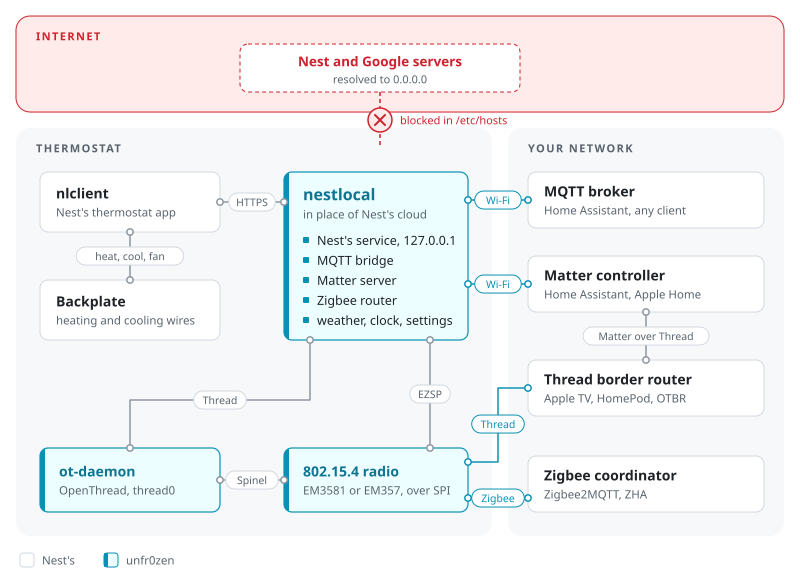
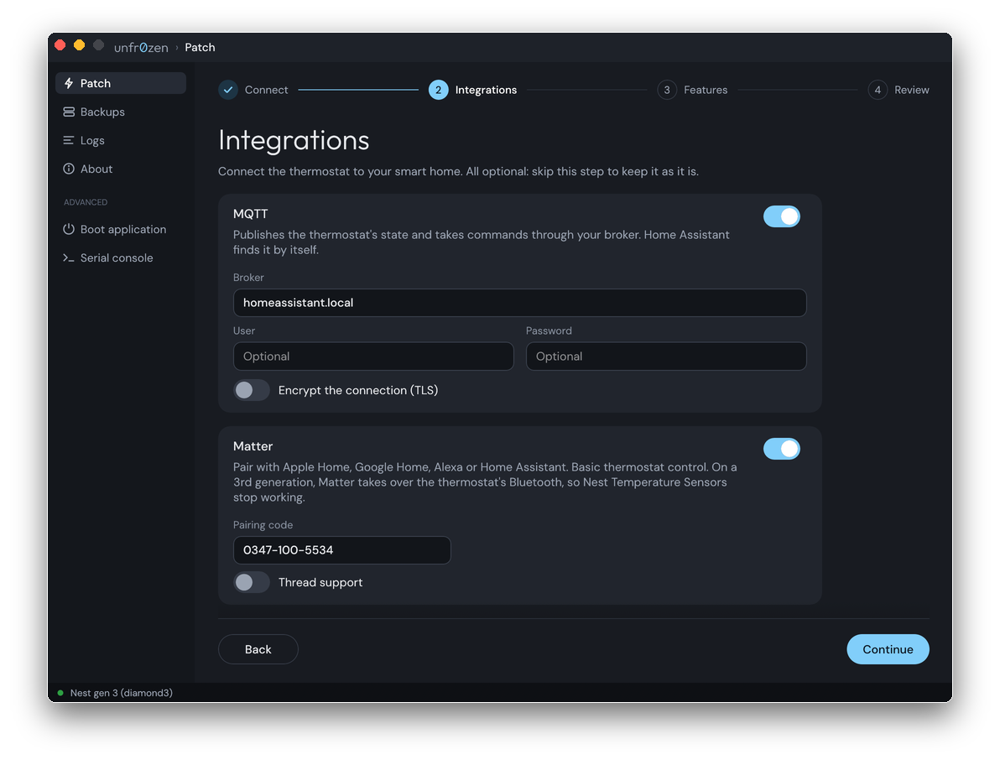

# unfr0zen
[](https://dl.circleci.com/status-badge/redirect/gh/unfr0zen/unfr0zen/tree/main)
[](https://github.com/unfr0zen/unfr0zen/releases)
[](LICENSE)
[](https://discord.gg/4YC7Yj3Tx)
[](https://buymeacoffee.com/willtm)

Root and free the Nest Learning Thermostat (1st, 2nd and 3rd generation) over USB.
Local control over MQTT, Matter (Wi-Fi, Thread) or Zigbee, no Google cloud needed.

> [!CAUTION]
> **This rewrites the flash of the device that runs your heating.** A failed run
> or a bad patch can leave the thermostat unbootable, or running without
> controlling your heating or cooling. Back up the NAND before the first run
> ([Undo it](#undo-it)) and have another way to heat or cool the house while you
> test.
>
> Claude Code has been used to speed up the app's GUI, the documentation and the
> tests. unfr0zen comes **without any warranty**: you use it at your own risk
> ([Disclaimers](#disclaimers)).

<picture>
  <source media="(prefers-color-scheme: dark)" srcset="assets/overview-dark.svg">
  
</picture>

## What you get

| | Stock | With unfr0zen |
|-|-|-|
| Control from | the Nest/Google Home app, through Google's cloud | Home Assistant or any MQTT client, Matter controller or Zigbee coordinator, on your network |
| Internet access | required | not needed: the unit only has to join your Wi-Fi |
| Nest and Google servers | always contacted | blocked with Block cloud (`--block-cloud`) |
| Integrations | none | MQTT, Matter over Wi-Fi or Thread, Zigbee router |
| Room temperature | the thermostat's own sensor, or Nest Temperature Sensors | any thermometer in Home Assistant too, with External temperature (`--external-temperature`) |
| Extras | none | SSH (`--ssh`), Doom (`--doom`), whole-NAND backup and restore |

## Supported thermostats

| Device | Codename | MQTT | Matter | Zigbee | External temperature |
|-|-|:-:|:-:|:-:|:-:|
| Nest Learning Thermostat (3rd generation) | `diamond3` | ✅ | ✅ Wi-Fi · ✅ Thread | ✅ | ✅ |
| Nest Learning Thermostat (2nd generation) | `j49` | ✅ | ✅ Wi-Fi · ✅ Thread | ✅ | ✅ |
| Nest Learning Thermostat (1st generation) | `diamond` | 🧪 | 🧪 Wi-Fi · — Thread | — | — |

✅ tested on a unit · 🧪 built, not yet tested on a unit · — not available

- **External temperature:** the thermostat regulates from a temperature you send
  it over MQTT, Matter or Zigbee (any thermometer in Home Assistant). Official
  Nest Temperature Sensors are not supported: on the 3rd generation the option
  turns Bluetooth off, and the 2nd generation never had them.
- **1st generation:** experimental. Patching has not been verified on a physical
  unit or a stock NAND. Its CC2530 radio uses UART, not the 2nd generation's SPI
  protocol, so there is no Zigbee, Matter over Thread or USB shell.
- **2nd generation:** Matter keeps the unit awake.
- **Thread and Zigbee** share the 2nd and 3rd generation's 802.15.4 radio (an
  EM357 or EM3581 on SPI), so only one of them can be on, and on European
  models either one replaces the wireless Heat Link connection. Zigbee drives
  it directly; Matter over Thread goes through OpenThread's `ot-daemon`.

MQTT, Matter and Zigbee are nestlocal's: choosing any of them installs it on the
thermostat. With MQTT or Matter, the thermostat reaches the broker or the
controller over Wi-Fi, joined from its own menu (Settings → Network); the
network doesn't need internet access.

### Tested firmware

| Device | Nest firmware |
|-|-|
| Nest Learning Thermostat (3rd generation) | 5.9.4-5, 6.3-5, 6.4-8, 6.5-14 |
| Nest Learning Thermostat (2nd generation) | 5.9.4-5 |

Other versions aren't blocked: unfr0zen patches them on their structure and
keeps the stock nlclient beside the run log. Running a version not listed here?
[Open an issue](https://github.com/unfr0zen/unfr0zen/issues) with the run log.

## Requirements
1. **A USB data cable.** Gen 1 uses mini-USB; Gen 2 and 3 use micro-USB. Charge-only cables won't work.
2. **Windows (x86_64, arm64), macOS 13+ (universal, arm64, x86_64) or Linux (x86_64, arm64, riscv64; glibc 2.28+).**

## Install
Download the latest build from the [releases page](https://github.com/unfr0zen/unfr0zen/releases).

- **Windows:** unzip and run `unfr0zen.exe`. 1st and 2nd generation: bind the WinUSB
  driver to the boot ROM (`0451:d00e`) once with [Zadig](https://zadig.akeo.ie).
- **macOS:** unzip and open `unfr0zen.app`. It is signed ad hoc, not notarized: run
  `xattr -dr com.apple.quarantine unfr0zen.app`, or allow it under System Settings → Privacy & Security.
- **Linux:** `tar xf unfr0zen-linux-x86_64-vX.Y.Z.tar.gz && ./unfr0zen`, after the one-time USB setup below.

<details>
<summary>Linux: USB access and runtime dependencies (click to expand)</summary>

Run both the app and CLI as your normal user, without `sudo`. Both need the
same one-time udev setup below; neither requests elevated privileges. Keep the
`70-` prefix: the rule has to run before systemd's `73-seat-late.rules` for
`uaccess` to grant the active local user USB access.

```sh
sudo tee /etc/udev/rules.d/70-unfr0zen.rules > /dev/null <<'EOF'
# i.MX ROM serial download, recovery U-Boot
ATTRS{idVendor}=="15a2", ATTRS{idProduct}=="0071", TAG+="uaccess", ENV{ID_MM_DEVICE_IGNORE}="1"
ATTRS{idVendor}=="18d1", ATTRS{idProduct}=="4ee0", TAG+="uaccess", ENV{ID_MM_DEVICE_IGNORE}="1"
# unfr0zen initramfs shell and the Nest application's console
ATTRS{idVendor}=="0525", ATTRS{idProduct}=="a4a7", TAG+="uaccess", ENV{ID_MM_DEVICE_IGNORE}="1"
ATTRS{idVendor}=="0525", ATTRS{idProduct}=="b4a4", TAG+="uaccess", ENV{ID_MM_DEVICE_IGNORE}="1"
ATTRS{idVendor}=="2464", ATTRS{idProduct}=="0030", TAG+="uaccess", ENV{ID_MM_DEVICE_IGNORE}="1"
ATTRS{idVendor}=="2464", ATTRS{idProduct}=="0031", TAG+="uaccess", ENV{ID_MM_DEVICE_IGNORE}="1"
# diamond/j49: OMAP boot ROM (and x-loader, the flasher), each application's gadget
ATTRS{idVendor}=="0451", ATTRS{idProduct}=="d00e", TAG+="uaccess", ENV{ID_MM_DEVICE_IGNORE}="1"
ATTRS{idVendor}=="2464", ATTRS{idProduct}=="0001", TAG+="uaccess", ENV{ID_MM_DEVICE_IGNORE}="1"
ATTRS{idVendor}=="2464", ATTRS{idProduct}=="0002", TAG+="uaccess", ENV{ID_MM_DEVICE_IGNORE}="1"
EOF
sudo udevadm control --reload-rules && sudo udevadm trigger
```

Reconnect the unit afterwards if it is already plugged in. The same rules cover
both the USB device and its HID/serial interfaces as it switches recovery modes.

Both frontends save logs to `~/.local/share/unfr0zen/logs/<timestamp>/unfr0zen.log`
(or `$XDG_DATA_HOME/unfr0zen/logs/<timestamp>/unfr0zen.log` when set). Errors creating
run or log directories include the affected path.

| Dependency | Why |
|-|-|
| A Wayland or X11 desktop with OpenGL or Vulkan drivers (Arch: `mesa`, or your GPU's driver) | Draws the window. |
| `xdg-desktop-portal` and the backend for your desktop (Arch: `xdg-desktop-portal-gtk`, `-kde` or `-gnome`) | The file picker for the MQTT CA certificate. |
| `libudev` (part of systemd) | USB access. |

</details>

## Usage
**App:** open it, tick the integrations on the Patch page, fill in their
settings (the MQTT broker, Matter's pairing code), plug in the thermostat,
press **Start** and follow the prompts. The sidebar's other pages are Backups
(the whole-NAND images the app keeps, with back up, restore and delete), Logs
(every run's steps and log), About and, under Advanced, the 3rd generation's
application boot and a serial console on a patched unit's USB root shell.

<p align="center"><a href="https://unfr0zen.com/"></a></p>

**CLI (Linux and macOS):** the same executable, run with arguments, works from a
terminal, over SSH or headless, with a few things the app doesn't have
(`--nand-image`, `verify`, `uboot`, `nlclient`). On macOS it is
`unfr0zen.app/Contents/MacOS/unfr0zen`. Windows has the app only.
```
unfr0zen [OPTIONS] [COMMAND]

Commands:
  backup    Back up the whole NAND to a file, checked with a second read
  verify    Compare a NAND backup with the NAND
  restore   Write a verified NAND backup back to the NAND
  boot      Boot the application firmware (3rd generation)
  uboot     Load recovery U-Boot over USB and leave it at its prompt (3rd generation)
  nlclient  Patch a local stock nlclient, or restore it from its undo journal

Common options:
  --device <GEN>         diamond, j49 or diamond3 instead of the USB identity
  --backup              Save the original root volume before patching
  --dry-run             List the changes, write nothing
  --mqtt <URL>          Relay to this MQTT broker
  --matter              Serve the unit over Matter (default code 0347-100-5534)
  --matter-thread       Serve Matter over Thread too (replaces Heat Link; excludes --zigbee)
  --zigbee              Join a Zigbee network as a router (replaces Heat Link)
  --external-temperature  Regulate from temperatures sent to it (2nd and 3rd generation; turns off the 3rd's Bluetooth)
  --doom                Install Doom, launched from UNFR0ZEN → Doom
  --ssh                 Run an SSH server on the unit
  --block-cloud         Cut the unit off from Nest's and Google's servers
```
Run `unfr0zen --help` for every option.

Setting up MQTT, Matter, Thread, Zigbee, the external temperature and Doom, with the app's and the CLI's
options side by side: [unfr0zen.com/integrations](https://unfr0zen.com/integrations/).

## Updating
Release builds keep themselves current: the window checks for a newer release
when it starts and offers to install it next to its version, and
`unfr0zen update` does the same for the command-line tool. On macOS the window
replaces its whole `unfr0zen.app`. Development builds (a `git describe` with
commits past a tag, or local changes) never update.

## Undo it
- **Before the first run:** the app's Backups page, Back up unit (or
  `unfr0zen backup`) saves the whole NAND to a file, checked with a second
  read. `unfr0zen verify` compares a backup with the unit.
- **To go back to stock:** Restore to unit (or `unfr0zen restore`) writes
  that backup back to the unit.
- `--backup` also saves the original root volume before each patch.

## When something is wrong
**The app doesn't see the thermostat.** Use a USB cable that carries data:
charge-only cables are the usual cause. Connect to the USB port on the back of
the detached display, not the power-only USB port on a European stand or Heat
Link base. On Windows, the 1st and 2nd generation need the WinUSB driver bound
to `0451:d00e` with [Zadig](https://zadig.akeo.ie). On Linux, add the
[udev rule](#install) and reconnect the unit.

**macOS won't open the app.** It is signed ad hoc, not notarized: run
`xattr -dr com.apple.quarantine unfr0zen.app`, or allow it under System
Settings → Privacy & Security.

**Home Assistant shows the thermostat offline.** The availability topic is
online only while the thermostat's app calls in to nestlocal and nestlocal is
connected to the broker. Check that the unit is on Wi-Fi (Settings → Network)
and that it reaches the broker URL you gave it.

Still stuck? [Open an issue](https://github.com/unfr0zen/unfr0zen/issues/new) with:
- How you ran it (app or CLI, with the options used) and the OS of your computer
- The full log of the run
- What the thermostat screen showed

## Disclaimers
unfr0zen is provided **as is, without any warranty**. We are **NOT** responsible
for any data loss, a bricked thermostat, damage to your heating or cooling
system, or anything else that happens to your device. By using unfr0zen you
accept full responsibility for the result.
- Modifying the thermostat voids its warranty and may break Google's services for it.
- Doom takes over the UI: while it runs the thermostat does not control the heating or cooling.
- Matter uses the test vendor ID (0xFFF1) and test attestation; controllers treat the unit as uncertified.
- unfr0zen is not affiliated with, endorsed or sponsored by Google LLC or Nest Labs.
  Nest and Nest Learning Thermostat are trademarks of Google LLC.

## Building
See [BUILDING.md](BUILDING.md).

## License
unfr0zen is licensed under the [GNU General Public License v3.0](LICENSE).
Bundled third-party components keep their own licenses: U-Boot and its patches
(GPL-2.0+), busybox (GPL-2.0), doomgeneric (GPL-2.0), the `zbwake` kernel
module (GPL-2.0). DOOM1.WAD is id Software's shareware episode, redistributed
under its shareware terms.

## Credits
- U-Boot (i.MX) — [NXP](https://github.com/nxp-imx/uboot-imx)
- BusyBox — [the BusyBox project](https://busybox.net)
- rs-matter — [Project CHIP](https://github.com/project-chip/rs-matter)
- OpenThread — [the OpenThread project](https://github.com/openthread/openthread)
- Gecko SDK / EmberZNet — [Silicon Labs](https://github.com/SiliconLabs/gecko_sdk)
- doomgeneric — [ozkl](https://github.com/ozkl/doomgeneric)
- DOOM — [id Software](https://github.com/id-Software/DOOM)
- CVE-2017-7932 and CVE-2017-7936 — [Quarkslab](https://quarkslab.com)
- diamond3 official loader — [@evan-hoddinott](https://github.com/evan-hoddinott)
- cuckoo loader (diamond/j49) — [@ajb142](https://github.com/ajb142)
