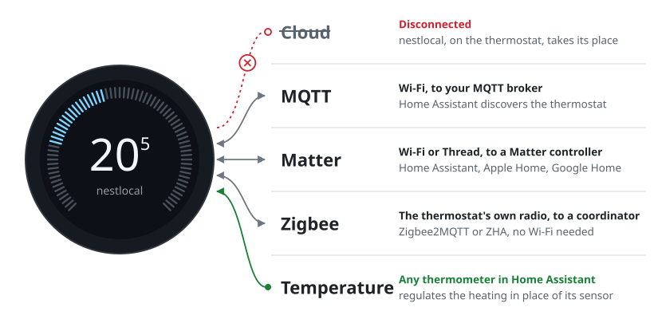
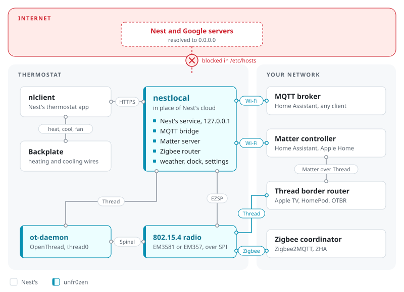
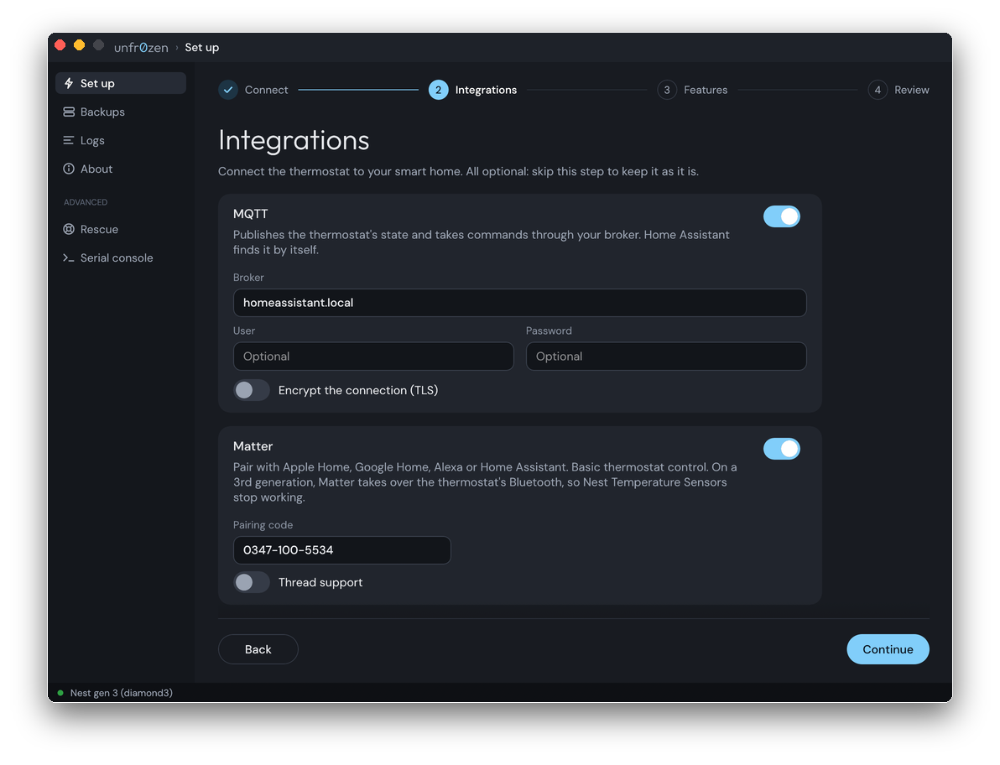

<div align="center">

# unfr0zen

[](https://dl.circleci.com/status-badge/redirect/gh/unfr0zen/unfr0zen/tree/main)
[](https://github.com/unfr0zen/unfr0zen/releases)
[](LICENSE)
[](https://discord.gg/fBqjAFARYg)
[](https://buymeacoffee.com/willtm)

**[Website](https://unfr0zen.com/) · [Download](https://unfr0zen.com/download/) · [Install guide](https://unfr0zen.com/install/) · [Integrations](https://unfr0zen.com/integrations/) · [Protocols](https://unfr0zen.com/protocols/)**

Root and free the Nest Learning Thermostat over USB.
Local control over MQTT, Matter (Wi-Fi, Thread) or Zigbee, no Google cloud needed.

</div>

> [!CAUTION]
> **This rewrites the flash of the device that runs your heating.** A failed run
> or a bad setup can leave the thermostat unbootable, or running without
> controlling your heating or cooling. Back up the NAND before the first run
> ([Undo it](#undo-it)) and have another way to heat or cool the house while you
> test.
>
> Claude Code has been used to speed up the app's GUI, the documentation and the
> tests. unfr0zen comes **without any warranty**: you use it at your own risk
> ([Disclaimers](#disclaimers)).

## More from the thermostat you already own

Keep working hardware useful. The line to Nest's cloud comes out, and three go
in to Home Assistant on your own network.

<p align="center">
<picture>
  <source media="(prefers-color-scheme: dark)" srcset="assets/routes-dark.svg">
  
</picture>
</p>

## How it works

<picture>
  <source media="(prefers-color-scheme: dark)" srcset="assets/overview-dark.svg">
  
</picture>

## Supported thermostats

| Device                                    | Codename   | MQTT | Matter                          | Zigbee | External<br>temperature |
| ----------------------------------------- | ---------- | :--: | :------------------------------ | :----: | :---------------------: |
| Nest Learning Thermostat (3rd generation) | `diamond3` |  ✅  | ✅&nbsp;Wi-Fi<br>✅&nbsp;Thread |   ✅   |           ✅            |
| Nest Learning Thermostat (2nd generation) | `j49`      |  ✅  | ✅&nbsp;Wi-Fi<br>✅&nbsp;Thread |   ✅   |           ✅            |
| Nest Learning Thermostat (1st generation) | `diamond`  |  ✅  | ✅&nbsp;Wi-Fi<br>—&nbsp;Thread  |   —    |           ✅            |

✅ supported · — not available

<sub>No other model is supported: not the Nest Thermostat E, any other Nest thermostat, or another make.</sub>

- **External temperature:** the thermostat regulates from a temperature you send
  it over MQTT, Matter or Zigbee (any thermometer in Home Assistant). Official
  Nest Temperature Sensors are not supported: on the 3rd generation the option
  turns Bluetooth off, and the 1st and 2nd generation never had them.
- **1st generation:** it has to be opened up to reach USB download mode: see the
  [install guide](https://unfr0zen.com/install/#gen1). It has no Zigbee, no
  Matter over Thread and no USB shell.
- **Thread and Zigbee** share the 2nd and 3rd generation's 802.15.4 radio (an
  EM357 or EM3581 on SPI), so only one of them can be on, and on European
  models either one replaces the wireless Heat Link connection.

Zigbee needs no Wi-Fi at all: the thermostat takes its clock and its updates
from the coordinator. That gives a new life to the many 2nd and 3rd generation
units whose Wi-Fi has failed.

### Tested firmware

| Device                                    | Nest firmware                 |
| ----------------------------------------- | ----------------------------- |
| Nest Learning Thermostat (3rd generation) | 5.9.4-5, 6.3-5, 6.4-8, 6.5-14 |
| Nest Learning Thermostat (2nd generation) | 5.9.4-5                       |
| Nest Learning Thermostat (1st generation) | 5.9.4-5                       |

Other versions aren't blocked: unfr0zen sets them up by their structure and
keeps the stock nlclient beside the run log. Running a version not listed here?
[Open an issue](https://github.com/unfr0zen/unfr0zen/issues) with the run log.

## Requirements

1. **A USB data cable.** Gen 1 uses mini-USB; Gen 2 and 3 use micro-USB. Charge-only cables won't work.
2. **Windows (x86_64, arm64), macOS 13+ (universal, arm64, x86_64) or Linux (x86_64, arm64, riscv64; glibc 2.28+).**

## Install

Download the latest build from the [releases page](https://github.com/unfr0zen/unfr0zen/releases).

- **Windows:** unzip and run `unfr0zen.exe`. 1st and 2nd generation: the first run
  installs the boot ROM's WinUSB driver (`0451:d00e`), after an administrator prompt.
- **macOS:** unzip and open `unfr0zen.app`. It is signed ad hoc, not notarized: run
  `xattr -dr com.apple.quarantine unfr0zen.app`, or allow it under System Settings → Privacy & Security.
- **Linux:** `tar xf unfr0zen-linux-x86_64-vX.Y.Z.tar.gz && ./unfr0zen`, after the one-time USB setup below.

<details>
<summary>Linux: USB access and runtime dependencies (click to expand)</summary>

Run both the app and CLI as your normal user, without `sudo`. Both need the
same one-time udev setup below; neither requests elevated privileges. Keep the
`70-` prefix: the rule has to run before systemd's `73-seat-late.rules` for
`uaccess` to grant the active local user USB access.

```sh
sudo tee /etc/udev/rules.d/70-unfr0zen.rules > /dev/null <<'EOF'
# i.MX ROM serial download, recovery U-Boot
ATTRS{idVendor}=="15a2", ATTRS{idProduct}=="0071", TAG+="uaccess", ENV{ID_MM_DEVICE_IGNORE}="1"
ATTRS{idVendor}=="18d1", ATTRS{idProduct}=="4ee0", TAG+="uaccess", ENV{ID_MM_DEVICE_IGNORE}="1"
# unfr0zen initramfs shell and the Nest application's console
ATTRS{idVendor}=="0525", ATTRS{idProduct}=="a4a7", TAG+="uaccess", ENV{ID_MM_DEVICE_IGNORE}="1"
ATTRS{idVendor}=="0525", ATTRS{idProduct}=="b4a4", TAG+="uaccess", ENV{ID_MM_DEVICE_IGNORE}="1"
ATTRS{idVendor}=="2464", ATTRS{idProduct}=="0030", TAG+="uaccess", ENV{ID_MM_DEVICE_IGNORE}="1"
ATTRS{idVendor}=="2464", ATTRS{idProduct}=="0031", TAG+="uaccess", ENV{ID_MM_DEVICE_IGNORE}="1"
# diamond/j49: OMAP boot ROM (and x-loader, the flasher), each application's gadget
ATTRS{idVendor}=="0451", ATTRS{idProduct}=="d00e", TAG+="uaccess", ENV{ID_MM_DEVICE_IGNORE}="1"
ATTRS{idVendor}=="2464", ATTRS{idProduct}=="0001", TAG+="uaccess", ENV{ID_MM_DEVICE_IGNORE}="1"
ATTRS{idVendor}=="2464", ATTRS{idProduct}=="0002", TAG+="uaccess", ENV{ID_MM_DEVICE_IGNORE}="1"
EOF
sudo udevadm control --reload-rules && sudo udevadm trigger
```

Reconnect the unit afterwards if it is already plugged in. The same rules cover
both the USB device and its HID/serial interfaces as it switches recovery modes.

Both frontends save logs to `~/.local/share/unfr0zen/logs/<timestamp>/unfr0zen.log`
(or `$XDG_DATA_HOME/unfr0zen/logs/<timestamp>/unfr0zen.log` when set).

| Dependency                                                                                                 | Why                                          |
| ---------------------------------------------------------------------------------------------------------- | -------------------------------------------- |
| A Wayland or X11 desktop with OpenGL or Vulkan drivers (Arch: `mesa`, or your GPU's driver)                | Draws the window.                            |
| `xdg-desktop-portal` and the backend for your desktop (Arch: `xdg-desktop-portal-gtk`, `-kde` or `-gnome`) | The file picker for the MQTT CA certificate. |
| `libudev` (part of systemd)                                                                                | USB access.                                  |

</details>

## Usage

**App:** open it, tick the integrations on the Set up page, fill in their
settings (the MQTT broker, Matter's pairing code), plug in the thermostat,
press **Start** and follow the prompts.

<p align="center"><a href="https://unfr0zen.com/"></a></p>

**CLI (Linux and macOS):** the same executable, run with arguments, works from a
terminal, over SSH or headless, with a few things the app doesn't have
(`--nand-image`, `verify`, `uboot`, `nlclient`). On macOS it is
`unfr0zen.app/Contents/MacOS/unfr0zen`. Windows has the app only.

```text
unfr0zen [OPTIONS] [COMMAND]

Commands:
  backup    Back up the whole NAND to a file, with its SHA-256
  verify    Compare a NAND backup with the NAND
  restore   Write a verified NAND backup back to the NAND
  boot      Boot the application firmware
  uboot     Load recovery U-Boot over USB and leave it at its prompt (3rd generation)
  nlclient  Patch a local stock nlclient, or restore it from its undo journal

Common options:
  --device <GEN>         diamond, j49 or diamond3 instead of the USB identity
  --mqtt <URL>          Relay to this MQTT broker
  --matter              Serve the unit over Matter (default code 0347-100-5534)
  --matter-thread       Serve Matter over Thread too (replaces Heat Link; excludes --zigbee)
  --zigbee              Join a Zigbee network as a router (replaces Heat Link)
  --external-temperature  Regulate from temperatures sent to it (turns off the 3rd generation's Bluetooth)
  --doom                Install Doom, launched from Settings → Doom
  --ssh                 Run an SSH server on the unit
  --block-cloud         Cut the unit off from Nest's and Google's servers
```

Run `unfr0zen --help` for every option.

Setting up MQTT, Matter, Thread, Zigbee, the external temperature and Doom, with the app's and the CLI's
options side by side: [unfr0zen.com/integrations](https://unfr0zen.com/integrations/).

## Updating

Once set up, the thermostat updates over the air, with no USB: each release's
package, `unfr0zen-<device>-<version>.ota`, installs over whichever
integration you use.

- **MQTT:** Home Assistant's **unfr0zen** update entity shows the latest
  release and installs it. A unit that can't reach GitHub takes the package's
  URL on your own network instead.
- **Matter:** from the controller's OTA provider, such as Home Assistant's
  Matter server.
- **Zigbee:** from Zigbee2MQTT's OTA page, with the converter. The package
  comes over Wi-Fi when the unit reaches GitHub, otherwise over Zigbee itself.

The thermostat installs only official releases signed with unfr0zen's release
key, never an older one, unless Allow unsigned updates was on at setup. Setup
for each: [unfr0zen.com/integrations](https://unfr0zen.com/integrations/).
The app keeps itself current too.

## Undo it

- **Before the first run:** the app's Set up page offers a backup of the
  whole NAND just before setting up, with the unit in recovery once for both;
  the Backups page's Back up unit (or `unfr0zen backup`) takes one on its
  own. `unfr0zen verify` compares a backup with the unit.
- **To go back to stock:** Restore to unit (or `unfr0zen restore`) writes
  that backup back to the unit.

## When something is wrong

**The app doesn't see the thermostat.** Use a USB cable that carries data:
charge-only cables are the usual cause. Connect to the USB port on the back of
the detached display, not the power-only USB port on a European stand or Heat
Link base. On Windows, accept the WinUSB driver's administrator prompt
([Install](#install)). On Linux, add the [udev rule](#install) and reconnect
the unit.

**Windows stops with `ACM interface for 18d1:4ee0 did not appear` (3rd generation).**
An Android driver installed earlier has claimed the recovery device, so its
console gets no COM port. While the thermostat is in recovery, open Device
Manager, find **Android Bootloader Interface**, choose Update driver → Browse
my computer → Let me pick → Universal Serial Bus devices → **USB Composite
Device**. The choice persists; run again.

**Home Assistant shows the thermostat offline.** The availability topic is
online only while the thermostat's app calls in to nestlocal and nestlocal is
connected to the broker. Check that the unit is on Wi-Fi (Settings → Network)
and that it reaches the broker URL you gave it.

Still stuck? Open a
[Bug Report](https://github.com/unfr0zen/unfr0zen/issues/new?template=001_bug_report.yml)
with the run's `unfr0zen.log` (see [CONTRIBUTING.md](CONTRIBUTING.md#issues)).

## Disclaimers

unfr0zen is provided **as is, without any warranty**. We are **NOT** responsible
for any data loss, a bricked thermostat, damage to your heating or cooling
system, or anything else that happens to your device. By using unfr0zen you
accept full responsibility for the result.

- Modifying the thermostat voids its warranty and may break Google's services for it.
- Matter uses the test vendor ID (0xFFF1) and test attestation; controllers treat the unit as uncertified.
- unfr0zen is not affiliated with, endorsed or sponsored by Google LLC or Nest Labs.
  Nest and Nest Learning Thermostat are trademarks of Google LLC.

## Building

See [BUILDING.md](BUILDING.md).

## Contributing

See [CONTRIBUTING.md](CONTRIBUTING.md).

## License

unfr0zen is licensed under the [GNU General Public License v3.0](LICENSE).
Bundled third-party components keep their own licenses: U-Boot and its patches
(GPL-2.0+), busybox (GPL-2.0), doomgeneric (GPL-2.0), the `zbwake` kernel
module (GPL-2.0). DOOM1.WAD is id Software's shareware episode, redistributed
under its shareware terms.

## Credits

- U-Boot (i.MX) — [NXP](https://github.com/nxp-imx/uboot-imx)
- BusyBox — [the BusyBox project](https://busybox.net)
- rs-matter — [Project CHIP](https://github.com/project-chip/rs-matter)
- OpenThread — [the OpenThread project](https://github.com/openthread/openthread)
- Gecko SDK / EmberZNet — [Silicon Labs](https://github.com/SiliconLabs/gecko_sdk)
- doomgeneric — [ozkl](https://github.com/ozkl/doomgeneric)
- DOOM — [id Software](https://github.com/id-Software/DOOM)
- CVE-2017-7932 and CVE-2017-7936 — [Quarkslab](https://quarkslab.com)
- diamond3 official loader — [@evan-hoddinott](https://github.com/evan-hoddinott)
- cuckoo loader — [@ajb142](https://github.com/ajb142)
- cuckoo loader gen 1 — [@guyman70718](https://github.com/guyman70718)
